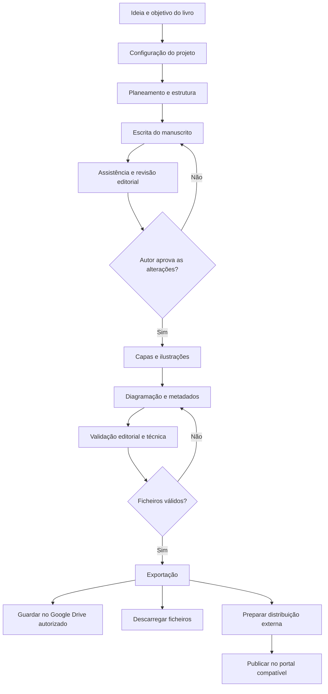
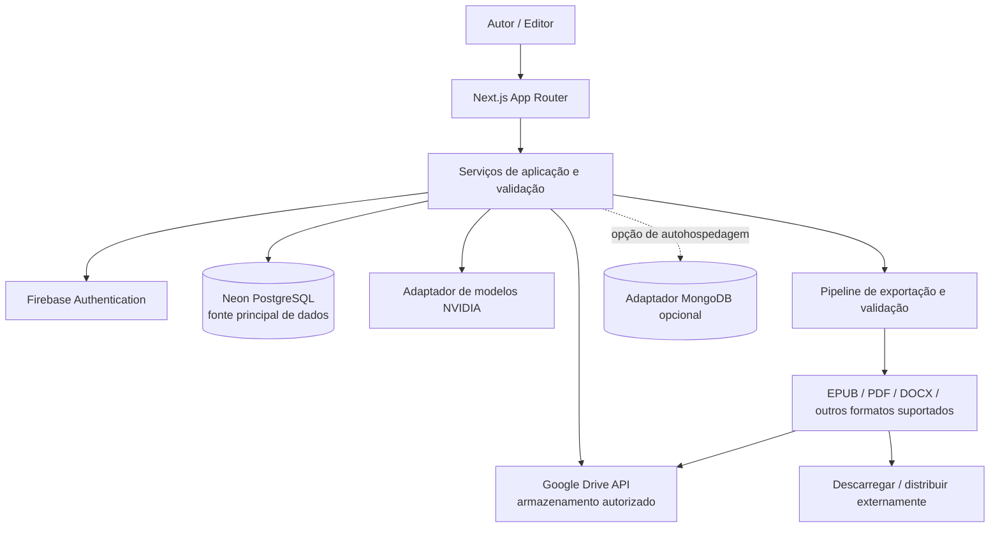

<div align="center">


# Book Studio

### Um estúdio editorial open source para levar uma ideia até um livro pronto para publicação.

**Planeamento · Escrita assistida por IA · Revisão editorial · Capas e ilustrações · Diagramação · Exportação · Distribuição**

[Visão geral](#-visão-geral) · [Arquitetura](#-arquitetura) · [Pipeline editorial](#-pipeline-editorial) · [Instalação](#-instalação-local) · [Configuração](#-configuração) · [Contribuir](#-contribuir)

<br />


<p><em>Um projeto em construção. As capacidades descritas como planeadas não devem ser interpretadas como integrações já implementadas ou testadas.</em></p>

</div>

---

## 📚 Visão geral

O **Book Studio** é uma plataforma editorial assistida por inteligência artificial, concebida para reunir num único fluxo o trabalho que normalmente fica espalhado por editores de texto, ferramentas de imagem, serviços de armazenamento, programas de paginação e portais de publicação.

A proposta é apoiar o autor desde a conceção até à preparação dos ficheiros finais: definir o livro, estruturar capítulos, escrever e rever o manuscrito, criar elementos visuais, configurar o projeto editorial, validar os formatos e exportar os materiais para publicação.

O autor mantém o controlo criativo. A IA é uma ferramenta de apoio: as sugestões não devem substituir silenciosamente o texto, alterar o manuscrito sem consentimento ou declarar que uma operação foi concluída sem confirmação real.

> **Princípio central:** um projeto editorial rastreável, com dados persistentes, integrações explícitas, erros visíveis e sem falsos estados de sucesso.

### Para quem é

| Público | Necessidade que o Book Studio pretende atender |
|---|---|
| ✍️ Autores independentes | Organizar ideias, desenvolver capítulos e preparar um livro sem gerir muitas ferramentas separadas. |
| 📖 Escritores e romancistas | Trabalhar com estrutura narrativa, continuidade, personagens, revisão e histórico do manuscrito. |
| 🎓 Investigadores, docentes e especialistas | Estruturar conteúdos técnicos, educativos e não ficcionais, mantendo a autoria e a revisão humana. |
| 🧑‍💻 Editores e revisores | Organizar o fluxo editorial, identificar problemas e rever versões de forma controlada. |
| 🎨 Criadores e ilustradores | Preparar capas, ilustrações e recursos visuais associados a cada projeto. |
| 🏢 Pequenas editoras e equipas | Explorar um fluxo de produção editorial com possibilidade de autohospedagem e extensão. |
| 🛠️ Programadores e comunidades open source | Inspecionar, adaptar, integrar e executar a plataforma na própria infraestrutura, respeitando a licença que vier a ser definida. |

### O que se pretende construir

- Gestão de projetos editoriais e respetivos metadados.
- Planeamento da obra, capítulos e manuscrito.
- Assistente conversacional contextualizado com o projeto.
- Revisão editorial com sugestões controladas pelo autor.
- Geração de capas e ilustrações, conforme as capacidades do modelo selecionado.
- Histórico de versões, estado de tarefas e sincronização.
- Configuração de dimensões, margens, tipografia e requisitos de impressão.
- Exportação de formatos digitais e preparados para impressão.
- Integração autorizada com Google Drive para armazenar manuscritos, recursos e exportações.
- Preparação para plataformas de distribuição, incluindo Amazon Kindle Direct Publishing, Apple Books, Kobo Writing Life e Google Play Books. A publicação direta só será indicada quando existir um fluxo de integração suportado; caso contrário, a plataforma prepara os ficheiros e encaminha o autor para o serviço externo.
- Configuração para execução na Vercel durante o desenvolvimento e possibilidade de adaptação para VPS.

---

## 🧭 Pipeline editorial

O fluxo abaixo descreve o processo de produto pretendido, não uma garantia de que todas as etapas já estão implementadas.



### Etapas e resultados esperados

1. **Definição:** título provisório, idioma, género, público, objetivo e formato pretendido.
2. **Planeamento:** estrutura, índice, capítulos, notas e objetivos de cada secção.
3. **Produção:** escrita e edição do manuscrito, com assistência contextual e decisões explícitas do autor.
4. **Revisão:** sugestões de clareza, gramática, coerência e consistência; alterações revistas antes de serem aplicadas.
5. **Design editorial:** capa, ilustrações e recursos gráficos organizados no projeto.
6. **Diagramação:** formato da página, margens, tipografia, cabeçalhos, paginação e outros elementos relevantes.
7. **Validação:** verificação de estrutura, metadados, recursos e requisitos do formato de destino.
8. **Entrega:** exportar, descarregar, guardar no Drive autorizado e preparar o processo de publicação.

---

## 🏗️ Arquitetura

A arquitetura separa a interface, os serviços de aplicação, os fornecedores externos e a persistência. Os componentes de interface não devem chamar diretamente APIs externas nem receber segredos de fornecedores.



### Stack tecnológica

| Camada | Tecnologia / decisão | Responsabilidade |
|---|---|---|
| Interface e rotas | Next.js App Router | Site público, aplicação e rotas de interface. |
| UI | React + TypeScript | Componentes e experiência responsiva. |
| Estilos | Tailwind CSS v4 | Sistema visual e layout adaptável. |
| Identidade | Firebase Authentication — planeado | Autenticação real e identidade do utilizador. |
| Base de dados principal | Neon PostgreSQL — planeado | Fonte de verdade relacional para projetos e metadados. |
| Armazenamento de ficheiros | Google Drive API — planeado | Guardar ficheiros mediante autorização do proprietário. |
| Modelos de IA | NVIDIA API — planeado | Acesso a modelos através de adaptadores e capacidades verificadas. |
| Base de dados alternativa | MongoDB — opcional e secundário | Opção para instalações autohospedadas em VPS, quando o adaptador estiver implementado. |
| Execução inicial | Vercel / ambiente Node.js | Pré-visualização e alojamento da aplicação web. |

### Regras arquiteturais

- **PostgreSQL é a fonte principal de verdade.** MongoDB é opcional e secundário; não se deve escrever a mesma entidade nas duas bases sem uma estratégia explícita de consistência, reconciliação e recuperação.
- **A interface não é uma fronteira de segurança.** O servidor deve validar identidade, autorização, propriedade dos recursos, entradas e limites de utilização.
- **Segredos apenas no servidor.** Chaves NVIDIA, segredos OAuth e credenciais de base de dados não podem ser expostos ao browser.
- **Persistência e sincronização são estados diferentes.** Guardar no editor, persistir na base de dados e sincronizar com o Drive devem ter confirmações distintas.
- **Integrações honestas.** Um serviço não configurado, indisponível ou sem permissões deve produzir um estado explícito, não uma resposta simulada.
- **Operações repetíveis com segurança.** Tarefas de sincronização e exportação devem procurar idempotência, identificadores estáveis, tentativas limitadas e estados de conflito.
- **Autor no controlo.** Alterações ao manuscrito, exportações e publicação exigem ações e confirmações claras.

---

## 🤖 Integrações de IA

O Book Studio pretende usar adaptadores de fornecedores para evitar que a lógica do produto fique presa a um único modelo ou formato de API.

### NVIDIA API

O adaptador deverá avaliar cada modelo individualmente, em vez de assumir que todos os modelos suportam as mesmas funções. A seleção deve considerar:

- Geração de texto e qualidade adequada à tarefa.
- Janela de contexto e limites de entrada/saída.
- Entrada de imagem ou visão, quando suportada.
- Geração de imagem, quando disponibilizada pelo fornecedor.
- Chamadas de ferramentas, se suportadas.
- Limites, disponibilidade, custos e erros do fornecedor.

A chave de API deve permanecer no servidor. A ausência de configuração ou a falha do fornecedor deve ser apresentada ao utilizador de forma explícita.

### Google Drive

O fluxo pretendido inclui autorização OAuth, pedido de permissões adequadas, criação ou utilização de uma pasta do Book Studio e armazenamento de manuscritos, recursos e exportações. A aplicação deve registar identificadores de ficheiros e estados de sincronização, tratar conflitos e permitir desligar a integração.

### Plataformas de publicação

O Book Studio pretende preparar livros para serviços como:

- Amazon Kindle Direct Publishing (KDP)
- Apple Books
- Kobo Writing Life
- Google Play Books

**Preparar para publicar não é o mesmo que publicar.** A publicação automática depende de APIs e permissões oficiais disponíveis para cada serviço. Quando não existir um fluxo direto suportado, a aplicação deverá validar e exportar os ficheiros, apresentar instruções e abrir o portal oficial. O estado “publicado” exige confirmação verificável.

---

## 💾 Dados e persistência

O modelo de domínio deverá separar os dados estruturados dos ficheiros binários e dos registos de execução.

| Entidade conceptual | Conteúdo esperado |
|---|---|
| Utilizador / espaço de trabalho | Identidade, preferências e âmbito de acesso. |
| Projeto editorial | Título, descrição, idioma, género, público, formato e estado. |
| Capítulo / documento | Conteúdo, ordenação, metadados e estado de revisão. |
| Revisão / versão | Alterações, autoria, data e possibilidade de recuperação. |
| Recurso visual | Capa, ilustração, formato, origem e referência do ficheiro. |
| Conversa | Mensagens de assistência associadas ao contexto autorizado. |
| Tarefa | Geração, revisão, exportação ou sincronização, com estado e erros. |
| Exportação | Formato, configuração, validação e referência ao ficheiro produzido. |
| Ligação externa | Fornecedor, permissões concedidas e estado da ligação, sem expor segredos. |

Esta é uma visão conceptual para orientar a implementação; não representa um esquema de base de dados já concluído.

### Organização prevista no Google Drive

```text
Book Studio/
└── <Livro>/
    ├── Manuscrito/
    ├── Capas-e-Ilustracoes/
    ├── Exportacoes/
    └── Publicacao/
```

A estrutura final deve ser criada apenas depois de o utilizador autorizar a integração. O conteúdo não deve ser enviado para o Drive sem consentimento.

---

## 🛡️ Segurança e privacidade

A segurança faz parte da arquitetura, não apenas da interface.

- Firebase Authentication e autorização validada no servidor para produção.
- Bloqueio de qualquer bypass de desenvolvimento em produção.
- Segredos de fornecedor apenas em variáveis de ambiente do servidor.
- Tokens OAuth protegidos em repouso e permissões mínimas necessárias.
- Validação do estado OAuth e dos callbacks.
- Isolamento dos projetos e recursos por utilizador ou espaço de trabalho.
- Limites de utilização para chamadas de IA e operações dispendiosas.
- Registos de auditoria para operações sensíveis, sem guardar segredos nos logs.
- Mensagens de erro claras, sem revelar credenciais ou detalhes internos desnecessários.
- Políticas de retenção e eliminação documentadas antes do lançamento de produção.

**Aviso:** qualquer acesso temporário para revisão visual é apenas um mecanismo de desenvolvimento. Não oferece autenticação real, não protege dados e nunca deve ser ativado no ambiente de produção.

---

## 🎨 Identidade visual

Os recursos de marca encontram-se no repositório:

| Recurso | Caminho |
|---|---|
| Logótipo vetorial | `public/brand/book-studio-logo.svg` |
| Ícone e favicon | `public/icon.svg` |
| Manifesto da aplicação web | `public/site.webmanifest` |
| Imagem de partilha Open Graph | `src/app/opengraph-image.svg` |
| Metadados globais | `src/app/layout.tsx` |

A direção visual utiliza fundo claro, azul institucional, tons de azul/ciano e componentes responsivos. A acessibilidade — navegação por teclado, foco visível, semântica e contraste — deve ser verificada ao longo do desenvolvimento.

---

## 🧰 Instalação local

### Pré-requisitos

- Node.js 22 ou versão compatível com o projeto.
- pnpm.
- Git.
- Credenciais de fornecedores apenas quando se pretender testar as integrações correspondentes.

### Executar

```bash
git clone https://github.com/flow-social-network/-book-studio.git
cd -book-studio
pnpm install
cp .env.example .env.local
pnpm dev
```

Abrir [http://localhost:3000](http://localhost:3000).

Comandos disponíveis no projeto:

```bash
pnpm dev        # servidor local de desenvolvimento
pnpm build      # compilação de produção
pnpm start      # servir a compilação produzida
pnpm lint       # análise estática com ESLint
pnpm typecheck  # verificação de tipos TypeScript
```

> Os comandos estão definidos no projeto, mas a sua execução e o resultado do build ainda precisam de ser verificados num ambiente de desenvolvimento. Não interprete a presença de um script como prova de que os testes passaram.

---

## ⚙️ Configuração

Copie `.env.example` para `.env.local` e preencha apenas os valores necessários ao serviço que pretende testar.

| Variável | Finalidade | Sensibilidade |
|---|---|---|
| `NEXT_PUBLIC_APP_URL` | URL pública da aplicação. | Pública |
| `NEXT_PUBLIC_DEV_AUTH_BYPASS` | Sinalizador temporário de acesso de desenvolvimento; nunca usar em produção. | Pública, mas perigosa se mal configurada |
| `NEXT_PUBLIC_FIREBASE_API_KEY` | Configuração do cliente Firebase. | Configuração pública; aplicar as restrições do Firebase |
| `NEXT_PUBLIC_FIREBASE_AUTH_DOMAIN` | Domínio de autenticação Firebase. | Pública |
| `NEXT_PUBLIC_FIREBASE_PROJECT_ID` | Identificador do projeto Firebase. | Pública |
| `NEXT_PUBLIC_FIREBASE_APP_ID` | Identificador da aplicação Firebase. | Pública |
| `DATABASE_URL` | Ligação à base de dados principal PostgreSQL. | **Segredo** |
| `GOOGLE_CLIENT_ID` | Cliente OAuth do Google. | Configuração de servidor |
| `GOOGLE_CLIENT_SECRET` | Segredo OAuth do Google. | **Segredo** |
| `GOOGLE_REDIRECT_URI` | URI de callback OAuth registado. | Configuração |
| `NVIDIA_API_KEY` | Chave para chamadas ao fornecedor NVIDIA. | **Segredo** |
| `NVIDIA_BASE_URL` | URL base da API NVIDIA. | Configuração |
| `MONGODB_URI` | Ligação opcional ao MongoDB secundário. | **Segredo** |
| `MONGODB_DATABASE` | Nome da base MongoDB opcional. | Configuração |

Não publique `.env.local`, tokens OAuth, chaves de API ou credenciais em commits, issues, screenshots ou logs. As integrações indicadas continuam dependentes da implementação e configuração correspondentes.

---

## 🗺️ Rotas e navegação

O inventário de rotas proposto está documentado em [docs/ROUTES.md](docs/ROUTES.md). Inclui:

- **Site público:** apresentação, funcionalidades, documentação, formatos, integrações, comunidade e páginas legais.
- **Autenticação:** entrar, registar, recuperar acesso, callbacks e onboarding.
- **Área de trabalho:** projetos, planeamento, manuscrito, capítulos, pesquisa, imagens, capas, diagramação, exportações e histórico.
- **IA:** assistência de escrita, geração de imagens e capas, tarefas e estado dos fornecedores.
- **Integrações:** Google Drive, NVIDIA e sincronização.
- **Administração:** utilizadores, modelos, fornecedores, tarefas, armazenamento, auditoria e saúde operacional.

O inventário é um plano de cobertura. A existência de uma rota na documentação não significa que a página, o endpoint ou o respetivo comportamento já estejam implementados.

---

## 🧪 Estratégia de qualidade

Antes de considerar uma funcionalidade pronta para produção, o projeto deverá passar por gates verificáveis:

1. **Qualidade estática:** TypeScript, ESLint e regras de formatação.
2. **Testes unitários:** validação de domínio, transformação de documentos e regras de exportação.
3. **Testes de integração:** persistência PostgreSQL, autorização, adaptadores e erros dos fornecedores.
4. **Testes end-to-end:** autenticação, criação de projeto, edição, recarregamento, exportação e desconexão de integrações.
5. **Persistência:** confirmar que o conteúdo permanece após atualizar a página ou iniciar nova sessão.
6. **Falhas:** simular timeout, permissões recusadas, limites de API, conflitos de sincronização e indisponibilidade de bases de dados.
7. **Exportação:** abrir e validar os ficheiros gerados e verificar requisitos do formato de destino.
8. **Segurança:** confirmar isolamento entre utilizadores, proteção dos segredos e bloqueio do bypass em produção.
9. **Entrega:** validar build de produção e comportamento em ambiente de pré-visualização antes de publicar.

Não se deve marcar uma operação como concluída apenas porque o utilizador clicou num botão. A confirmação deve vir da operação real.

---

## 🚦 Estado do desenvolvimento

Este repositório está em desenvolvimento incremental. A base inicial inclui a configuração Next.js, a página pública, páginas iniciais de interface e documentação arquitetural. O trabalho de produto e as integrações reais continuam em curso.

| Área | Estado documentado |
|---|---|
| Estrutura Next.js e identidade visual inicial | Parcialmente criada |
| Página pública e documentação inicial | Parcialmente criadas |
| Inventário de rotas e arquitetura planeada | Documentado |
| Autenticação Firebase com autorização no servidor | Por implementar e testar |
| Esquema/migrações Neon e persistência de projetos | Por implementar e testar |
| Editor e histórico durável do manuscrito | Por implementar e testar |
| OAuth, carregamento e sincronização Google Drive | Por implementar e testar |
| Adaptador NVIDIA para texto/imagem | Por implementar e testar |
| Exportação real e validação de impressão | Por implementar e testar |
| Adaptador MongoDB secundário | Por implementar e testar |
| Testes automatizados e validação de produção | Não confirmados |

A fonte detalhada de acompanhamento é [docs/DEVELOPMENT_STATUS.md](docs/DEVELOPMENT_STATUS.md). Não existem neste README afirmações de que todas as integrações estejam operacionais.

---

## 🤝 Contribuir

Contribuições são bem-vindas. Antes de abrir uma alteração:

1. Leia [docs/PRODUCT_SPEC.md](docs/PRODUCT_SPEC.md) e [docs/ARCHITECTURE.md](docs/ARCHITECTURE.md).
2. Identifique a fronteira arquitetural afetada e evite misturar interface, domínio e fornecedores externos.
3. Não adicione chaves, credenciais, dados pessoais reais ou ficheiros de utilizadores.
4. Não introduza mocks que possam ser confundidos com dados persistidos ou operações reais.
5. Acrescente testes para comportamentos novos e cenários de falha.
6. Documente variáveis de ambiente, migrações e limitações relevantes.
7. Descreva no pull request o comportamento observado e os comandos realmente executados.

### Princípios para contribuições

- TypeScript com tipos explícitos e contratos claros.
- Responsabilidades pequenas e limites de módulo bem definidos.
- Validação de entradas na fronteira do sistema.
- Erros explícitos e estados de carregamento/sincronização verdadeiros.
- Sem segredos no cliente.
- Sem dependência obrigatória de MongoDB para o caminho principal PostgreSQL.
- Sem prometer publicação automática quando só existe exportação ou encaminhamento para um portal.

### Licença

**A licença open source ainda não foi selecionada.** Até que uma licença seja adicionada ao repositório, não assuma que o código está licenciado para redistribuição ou uso conforme uma licença específica. A escolha e a inclusão de um ficheiro `LICENSE` são necessárias para formalizar os termos de contribuição e utilização.

---

## 📖 Documentação técnica

- [Especificação do produto](docs/PRODUCT_SPEC.md)
- [Arquitetura](docs/ARCHITECTURE.md)
- [Inventário de rotas](docs/ROUTES.md)
- [Estado do desenvolvimento](docs/DEVELOPMENT_STATUS.md)

<div align="center">

**Book Studio** · Da ideia ao livro, com o autor no controlo.

<sub>Construído para ser inspecionável, extensível e honesto sobre o que está — e o que ainda não está — implementado.</sub>

</div>
